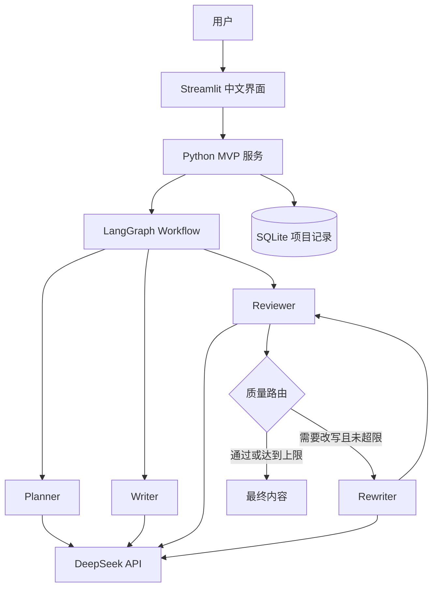
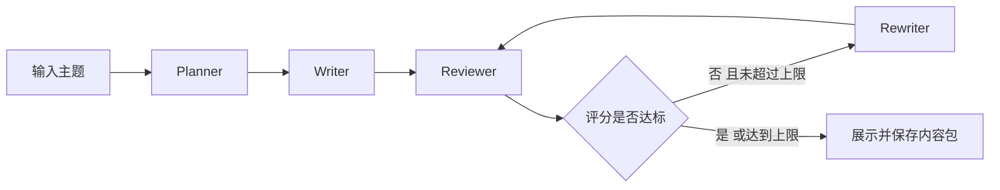

# ContentFlow AI

ContentFlow AI 是一个中文优先的 AI 内容创作应用 MVP。用户输入主题后，系统依次完成内容策划、初稿生成、质量审阅和受限改写，并保留每个阶段的产物，帮助用户检查 AI 的结果，而不只得到一段最终文本。

> 当前版本适合本地 Demo、课程项目展示和 AI 应用工程学习。生成内容仍需要人工核查关键事实、引用与适用范围。

## 项目解决的问题

从一个主题到可发布内容，通常要经历资料整理、结构规划、写作、审阅和多轮修改。通用聊天工具可以生成文本，但过程往往不可观察，也难以判断内容是否真的变好。

ContentFlow AI 将创作拆成可检查的 Workflow：先规划，再写作、审阅和改写；每一步都保留中间结果和质量信息，便于用户决定是否采纳。

## 当前能力

- 中文 Streamlit 工作台：输入主题并查看内容计划、初稿、审阅报告和修订稿。
- Planner：生成带受众、语气和章节目标的结构化内容计划。
- Writer：根据确认的内容计划生成初稿。
- Reviewer：从结构、清晰度、受众语气和完整度四个维度给出评分与修改建议。
- Rewrite Loop：当评分低于阈值时，最多改写一次，避免无限循环。
- SQLite：保存已完成项目的核心产物与运行标识。
- 可观测性与错误提示：记录运行 ID、节点、调用次数和可识别错误；UI 提供中文提示。

以下能力已作为独立模块或工作流组件实现并有测试覆盖，但尚未完整开放到当前网页的主流程：本地演示资料 Research、RAG 检索、平台内容适配、视觉素材规划。

## Demo

本地启动后，在网页中输入一个主题，例如：

```text
面向大学新生，写一篇说明如何建立可持续学习习惯的文章。
```

页面会展示计划、初稿、审阅报告和修订稿。提交主题后才会调用模型。

原型参考：[ContentFlow AI Prototype](https://www.figma.com/design/nDMYbpCC11T3HTC6iVejEP/ContentFlow-AI-Prototype?m=dev&t=WCjwKWad43EvN2Mt-1)

## 系统架构



## 当前网页 Workflow



Research Workflow 额外支持证据优先路由：证据不足时先补充资料，再判断是否需要改写。策略阈值和循环预算由 `ResearchWorkflowPolicy` 集中管理。

## 技术栈

| 层次 | 技术 | 作用 |
| --- | --- | --- |
| UI | Streamlit | 快速构建中文交互界面 |
| 应用语言 | Python 3.11+ | 业务逻辑与工具集成 |
| LLM | DeepSeek API 兼容 OpenAI SDK | 内容生成与结构化任务 |
| Workflow | LangGraph | 状态、路由和受限循环 |
| 数据模型 | Pydantic | 结构化输出与输入校验 |
| 存储 | SQLite | 本地项目记录 |
| 质量保障 | pytest、Ruff | 自动化回归与静态检查 |

## 项目结构

```text
contextai/
├── app.py                       # Streamlit 入口
├── src/contentflow/
│   ├── workflow/                # LangGraph 基础与 Research 工作流
│   ├── agents/                  # Research、Visual Agent
│   ├── rag/                     # 本地 RAG 与评测
│   ├── database/                # SQLite 项目仓储
│   ├── planner.py               # 内容策划
│   ├── writer.py                # 初稿生成
│   ├── reviewer.py              # 质量审阅
│   ├── rewriter.py              # 受限改写
│   └── llm_client.py            # 统一 LLM 客户端配置
├── prompts/                     # 与业务代码解耦的 Prompt
├── tests/                       # 自动化测试
├── docs/                        # Word 格式的产品与学习文档
├── data/                        # 演示资料与本地运行目录
└── tools/                       # 文档和开发辅助脚本
```

## 安装

前提：Python 3.11 或更高版本，以及可用的 DeepSeek API Key。

```powershell
git clone <你的仓库地址>
Set-Location contextai

python -m venv .venv
.\.venv\Scripts\Activate.ps1
python -m pip install -e ".[dev]"
Copy-Item .env.example .env
```

macOS 或 Linux 可将激活命令替换为：

```bash
source .venv/bin/activate
```

## 配置

复制 `.env.example` 为 `.env`，并只在本机 `.env` 中填写真实 Key：

```env
LLM_PROVIDER=deepseek
LLM_MODEL=deepseek-chat
LLM_BASE_URL=https://api.deepseek.com
LLM_TIMEOUT_SECONDS=30
DEEPSEEK_API_KEY=你的真实密钥
DATABASE_URL=sqlite:///./data/contentflow.db
```

`.env` 和运行时 SQLite 数据库均已被 Git 忽略。不要把真实 Key 写入 README、文档、测试或 Commit。

## 运行

先检查配置可被读取；该命令不调用模型：

```powershell
python -m contentflow
```

启动网页：

```powershell
streamlit run app.py
```

浏览器通常会打开 `http://localhost:8501`。若端口被占用，可追加 `--server.port 8502`。

## 测试

以下测试不会调用真实 LLM：

```powershell
python -m pytest -p no:cacheprovider -q
python -m ruff check src tests
```

当前回归基线：`106 passed`，Ruff 通过。

## 已知限制

- 当前 UI 只暴露主题输入和基础创作 Workflow，尚未提供 Research、Adapter、Visual 的完整交互入口。
- Research 使用本地演示资料，不等同于实时网络搜索。
- SQLite 适合本机 Demo；部署到无持久磁盘的平台时，历史项目不会保留。
- 没有用户登录、多租户隔离或云端协作能力。
- AI 输出可能出错，用户仍需核查关键事实、来源和适用范围。

## Roadmap

- 将受众、内容类型、输出平台和 Research 控制项开放到 UI。
- 接入可验证的实时检索，并在内容中保留来源。
- 为部署目标配置 Secret、持久化存储和运行环境。
- 增加项目历史浏览、版本对比与人工反馈机制。
- 补充多用户权限与协作能力。

## 开发与学习记录

项目按 `contentflow-ai-full-project-SKILL.md` 的阶段推进。`docs/` 保存产品、架构、测试、Review 和部署前检查的 Word 学习记录；代码与文档均以可运行、可测试和可复盘为目标。
